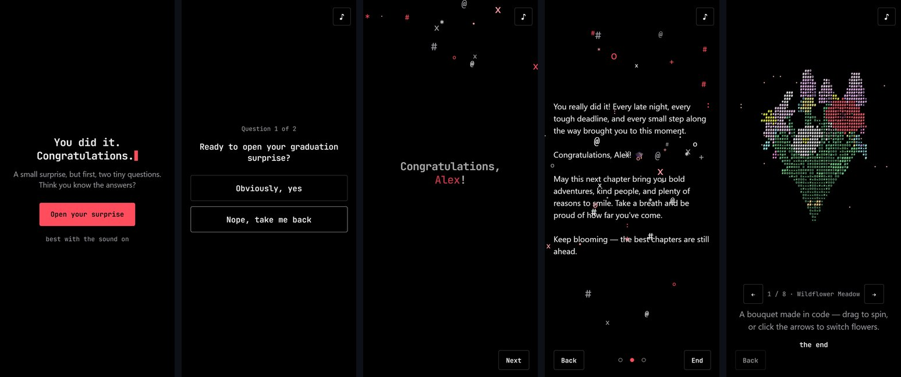
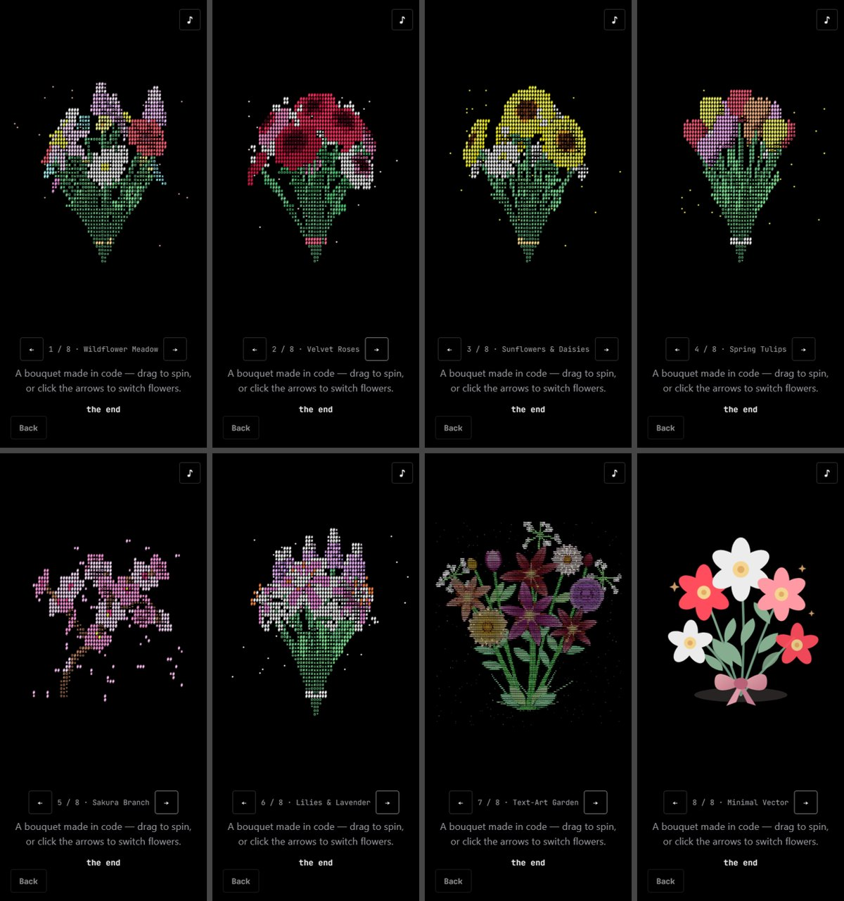

# Graduation Flower Card

A small interactive graduation card you can personalise and send as a link. The visitor answers two playful questions, gets a "Congratulations" with confetti, reads your typed message, and finally sees a bouquet bloom, drawn entirely in code.

It is plain HTML, CSS and JavaScript: no framework, no build step, no images for the flowers. Edit one file, upload the folder, and share the link.

### [▶ Play the live demo](https://azrinfreeman.github.io/graduation-flower-card/)

Works on phones and desktops. Turn your sound on for the effects.



## How the card plays

1. **Cover.** The heading types itself in. One tap opens the card.
2. **Two questions.** Write your own inside jokes. The wrong answer runs away from the pointer or finger, then gives up after a few tries, so nobody gets stuck.
3. **Congratulations.** The name appears with a burst of text-character confetti.
4. **Your message.** It types out at a readable size and splits into pages on small screens, so nothing ever scrolls.
5. **The bouquet.** Flowers bloom on the last page. Visitors can drag to spin them and use **← / →** to try all eight styles.

## Eight bouquet styles



| # | Style | Look |
|---|---|---|
| 1 | Wildflower Meadow | 3D poppies, daisies, cornflowers, lupines and lilies |
| 2 | Velvet Roses | 3D layered roses with baby's breath |
| 3 | Sunflowers & Daisies | 3D sunflowers with chamomile daisies |
| 4 | Spring Tulips | 3D cupped tulips with long leaves |
| 5 | Sakura Branch | 3D cherry-blossom branch with falling petals |
| 6 | Lilies & Lavender | 3D lilies, lavender spikes and baby's breath |
| 7 | Text-Art Garden | Detailed flat bouquet in text characters |
| 8 | Minimal Vector | Simple animated SVG illustration |

The 3D styles are point clouds rendered as coloured text characters on a canvas, and they turn on their own.

## Also included

- **Sound effects:** eight short CC0 clips (a paper page turn, soft chimes, a pop when the wrong answer runs away) with one corner volume control. Try them on the [sound board](https://azrinfreeman.github.io/graduation-flower-card/tools/sound_board.html).
- **Optional background song:** off by default. Add your own MP3 and it fades in quietly after the first tap.
- **Fits every screen:** tested from 320 px phones to wide desktops, portrait and landscape.
- **Keyboard and screen-reader friendly:** every control works with Tab and Enter, and the bouquet turns with the arrow keys.
- **No tracking:** no analytics, cookies or third-party requests.

---

## Customize in 2 Minutes

Download or fork this repository, then edit **[`js/config.js`](js/config.js)**:

| Setting | What it changes |
|---|---|
| `graduateName` | The graduate's name on the congratulations page |
| `senderSignature` | Your signature line under the heading |
| `graduationMessage` | Your wish (use `\n\n` for new paragraphs; long messages paginate automatically) |
| `questions` | Your own fun questions, options, and `correctAnswer` |
| `runawayWrongAnswer` | Toggle `enabled`, dodge count (`giveUpAfter`), hint glow (`hintAfter`), and tease messages |
| `bouquetPicker.enabled` | `true` lets visitors click **← / →** to browse all bouquets; `false` locks to the first bouquet |
| `bouquetGallery` | Reorder, remove, or recolor any of the 8 bouquet styles (the first entry blooms first) |
| `sfx` | Set `enabled: false` to turn off effects, or change a path in `files` to use your own licensed clip |
| `music` | Set `enabled: true`, place your MP3 in `assets/audio/`, and set `src` and `note` |

To change colors or typography, edit the CSS variables at the top of [`css/main.css`](css/main.css).

### Adding your own background song

Background music is **off by default**. Supply a track you have rights to use.

1. Put your MP3 file in `assets/audio/` (for example `assets/audio/your-song.mp3`).
2. In `js/config.js`, set:
   ```js
   music: {
     enabled: true,
     src: 'assets/audio/your-song.mp3',
     volume: 0.15,
     note: 'Why I picked this song for you.',
   }
   ```

---

## Run Locally

Because the site uses ES modules, serve it over HTTP rather than opening `index.html` directly via `file://`:

```bash
python tools/serve.py
```

Then open [the card](http://localhost:8000/) in your browser.

Open the [sound board](http://localhost:8000/tools/sound_board.html) to try each cue at the card’s default volume. To swap a sound, put your clip in `assets/audio/sfx/` and update its path under `sfx.files` in `js/config.js`.

---

## Deploy for Free

### GitHub Pages
1. Fork this repository and customize `js/config.js`.
2. In your GitHub repository go to **Settings → Pages**.
3. Under **Build and deployment**, select **Deploy from a branch**, pick `main` and `/ (root)`, then save.

### Cloudflare Pages
Run the bundle script to copy only runtime files into `site/`:

```bash
python tools/build_site.py
```

Upload the generated `site/` folder in the Cloudflare Pages dashboard or run `npx wrangler pages deploy site`. See [`docs/DEPLOYMENT_AND_QR.md`](docs/DEPLOYMENT_AND_QR.md) for QR code generation too.

---

## Verify Before Deploying

```bash
python tools/verify_project.py
```

---

## Licenses & Credits

- Code & procedural flower artwork: **MIT License** ([`LICENSE`](LICENSE))
- Self-hosted heading font: **JetBrains Mono** under the SIL Open Font License 1.1 ([`assets/fonts/OFL-JetBrains-Mono.txt`](assets/fonts/OFL-JetBrains-Mono.txt))
- Sound effects: **CC0 1.0** from Kenney and UI SFX
- See [`docs/ASSETS_AND_LICENSES.md`](docs/ASSETS_AND_LICENSES.md) for details.
